# 🍽️ Sabor Local


Aplicación móvil nativa para Android de reseñas de restaurantes, desarrollada para la asignatura **Aplicaciones Móviles para IoT (`TI3V42`)**, correspondiente a la **Evaluación Sumativa N°1 (ES1: Interfaz de la app)** en **INACAP Sede Puente Alto**.

> **Nota de privacidad y alcance:** Este proyecto corresponde exclusivamente a la capa de interfaz de usuario y gestión de recursos de la aplicación, utilizando datos de ejemplo ficticios. No contiene datos reales de usuarios, correos personales ni credenciales o claves sensibles.

---

## 📋 Descripción General

**Sabor Local** permite explorar, registrar, consultar y gestionar reseñas de locales gastronómicos, incorporando además una pantalla dedicada a sugerencias y recomendaciones personalizadas mediante asistencia inteligente.

---

## 📱 Pantallas Implementadas

La arquitectura de interfaz contempla **6 Activities y sus respectivos Layouts XML** diseñados bajo estándares de accesibilidad y Material Design 3:

| Pantalla | Activity | Layout XML | Funcionalidad Principal |
| :--- | :--- | :--- | :--- |
| **Inicio de Sesión** | `LoginActivity` | `activity_login.xml` | Identidad visual con logotipo, nombre de la app, campos de correo y contraseña, opción de recordar sesión y botón de ingreso. |
| **Registro** | `RegistroActivity` | `activity_registro.xml` | Formulario de alta de usuario, confirmación de clave, selector de preferencia gastronómica (`RadioGroup`), aceptación de términos y creación de cuenta. |
| **Listado** | `ListaActivity` | `activity_lista.xml` | Encabezado con barra de acciones rápidas y listado desplazable (`ScrollView`) con tarjetas de reseñas de ejemplo (*La Picada de Ñuñoa*, *Trattoria Bella* y *Sushi Norte*). |
| **Nueva Reseña** | `AgregarActivity` | `activity_agregar.xml` | Formulario desplazable (`ScrollView`) para registrar un local (nombre, tipo de comida, comuna, puntaje del 1 al 5 y comentario), con áreas táctiles ≥ `48dp`, `autofillHints` y contraste optimizado. |
| **Detalle** | `DetalleActivity` | `activity_detalle.xml` | Vista completa de una reseña con ficha del local, valoración, historial de visitas, comentario, interruptor de favorito (`MaterialSwitch`) y acciones para editar o eliminar. |
| **Recomendaciones IA** | `IaActivity` | `activity_ia.xml` | Campo de entrada para preferencias o antojos del usuario, botón de solicitud y panel desplazable de respuesta con sugerencias. |

---

## 🎨 Recursos, Tema e Identidad Visual

El diseño sigue una estructura modular de recursos para garantizar mantenibilidad, accesibilidad y soporte nativo de temas:

- **Textos y Accesibilidad (`res/values/strings.xml`):** Centralización total de cadenas de texto visibles, textos guía (`hint`), descripciones de contenido (`contentDescription`) para lectores de pantalla e identidad de la aplicación (`Sabor Local`).
- **Paleta Semántica y Modo Oscuro (`res/values/colors.xml`, `res/values-night/colors.xml`, `res/values/themes.xml`):** Definición de colores por función (`primario`, `fondo_pantalla`, `fondo_tarjeta`, `texto_principal`, `texto_secundario`) con adaptación automática entre **Modo Claro** (`#B3382C` sobre `#FFFFFF`) y **Modo Oscuro** (`#FFB4A8` sobre `#1C1B1F`) bajo `Theme.Material3.DayNight.NoActionBar`.
- **Estilos Reutilizables:** Definición e implementación de estilos propios (`Estilo.Titulo` y `Estilo.Boton.Principal`) para mantener consistencia tipográfica y cromática en todas las vistas.
- **Ícono Adaptativo Propio:** Generado mediante *Android Studio Image Asset Studio* a partir de `logo_sabor_local.webp`, configurado con fondo `#FBF3E4` y distribuido en los directorios `res/mipmap-*` junto a `res/values/ic_launcher_background.xml`.

---

## 🛠️ Requisitos del Entorno

- **IDE:** Android Studio (versión institucional instalada)
- **SDK de Compilación (`compileSdk`):** API 36
- **SDK Mínimo (`minSdk`):** API 24 (Android 7.0)
- **Lenguaje:** Kotlin (JVM Target 11)

---

## 📂 Estructura de Recursos Clave

```text
app/src/main/
├── java/com/example/saborlocal/
│   ├── LoginActivity.kt
│   ├── RegistroActivity.kt
│   ├── ListaActivity.kt
│   ├── AgregarActivity.kt
│   ├── DetalleActivity.kt
│   └── IaActivity.kt
└── res/
    ├── drawable/          # Logotipo e íconos vectoriales
    ├── layout/            # 6 archivos XML de interfaz
    ├── mipmap-*/          # Ícono adaptativo de la aplicación
    ├── values/            # strings.xml, colors.xml, arrays.xml, themes.xml
    └── values-night/      # colors.xml y themes.xml (Modo Oscuro)
``` 

## 📸 Capturas de Pantalla

| Pantalla | Modo Claro | Modo Oscuro |
| :--- | :---: | :---: |
| **Splash / Carga** | 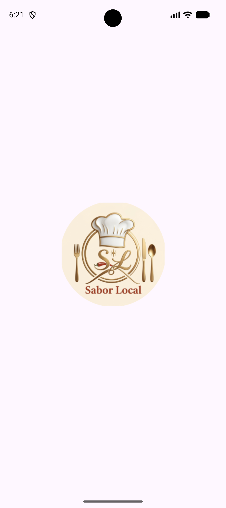 | 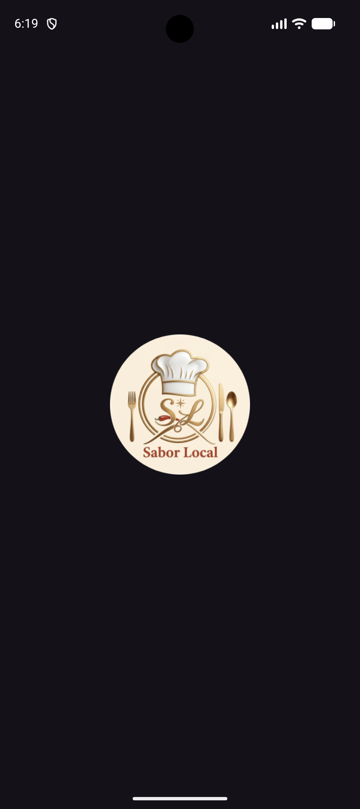 |
| **Inicio de Sesión** | 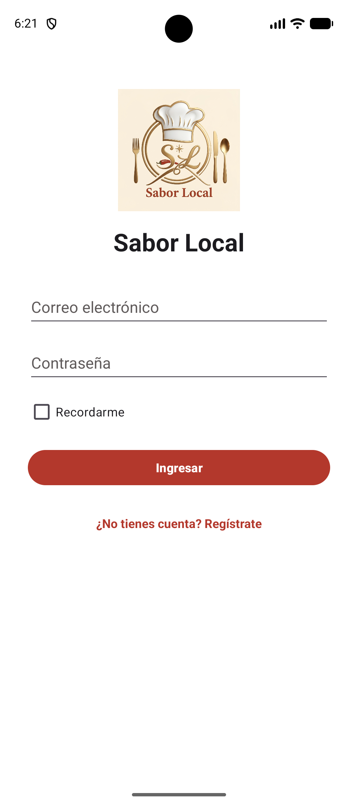 | 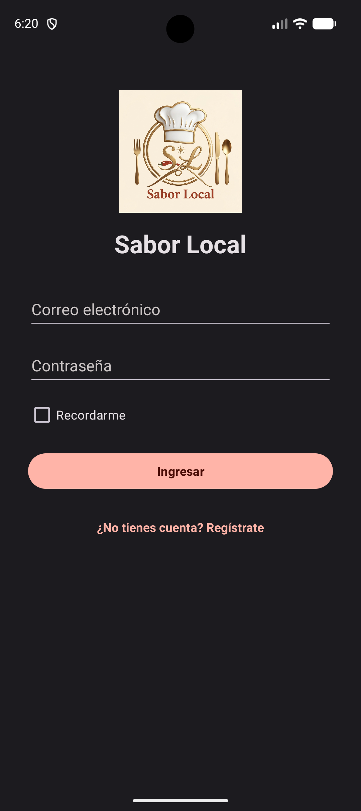 |
| **Registro** | 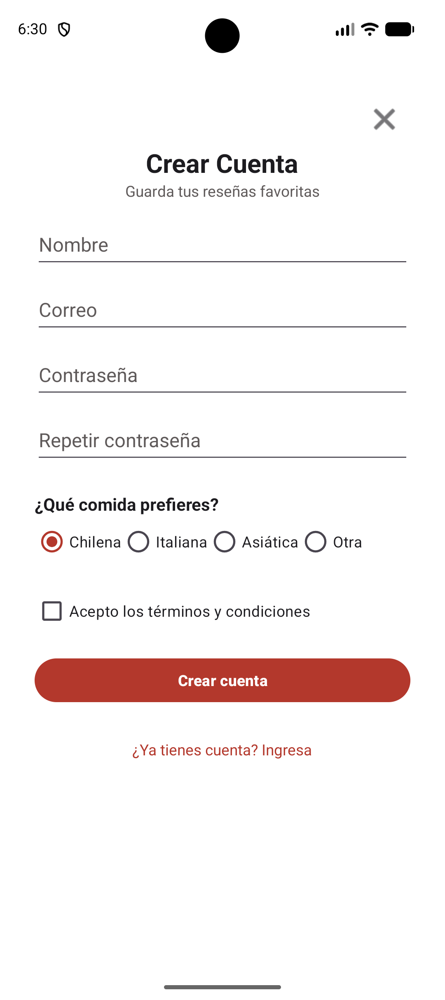 | 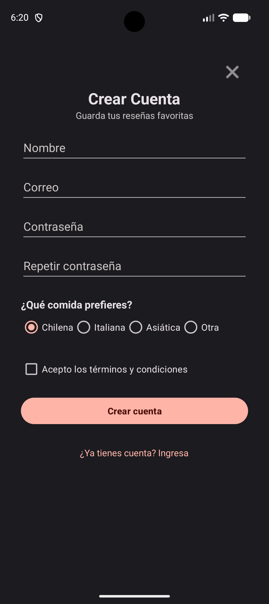 |
| **Listado** | 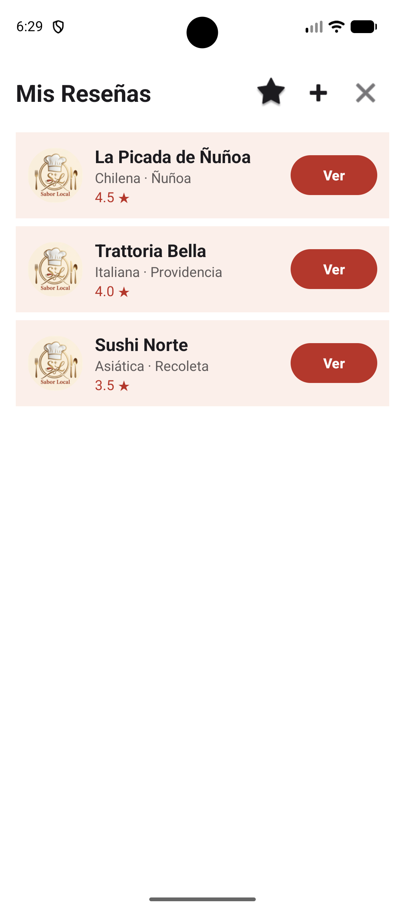 | 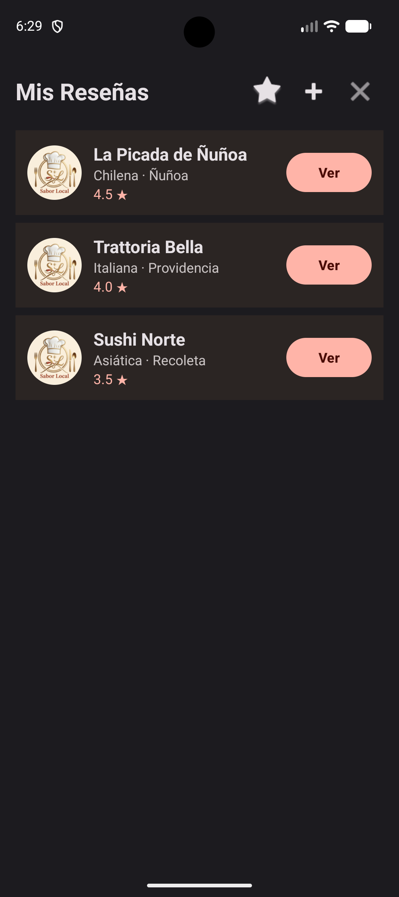 |
| **Nueva Reseña** | 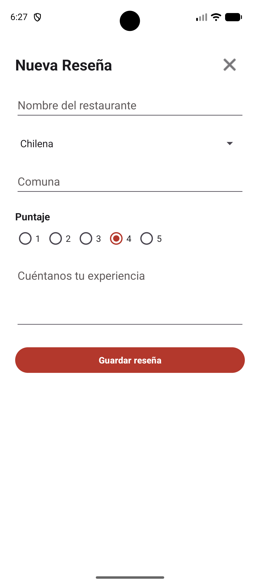 | 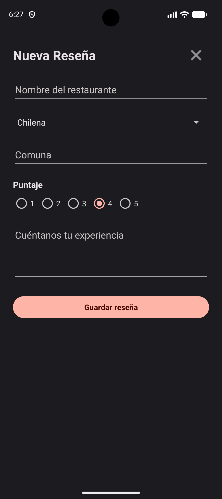 |
| **Detalle** | 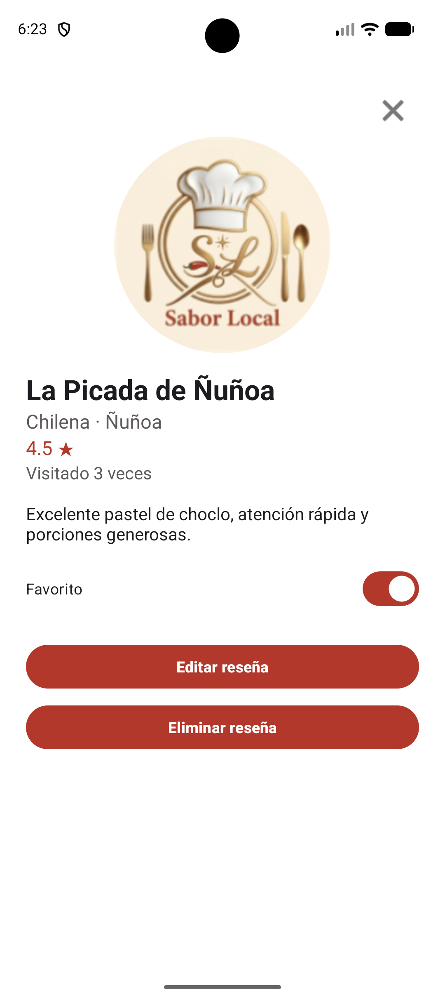 | 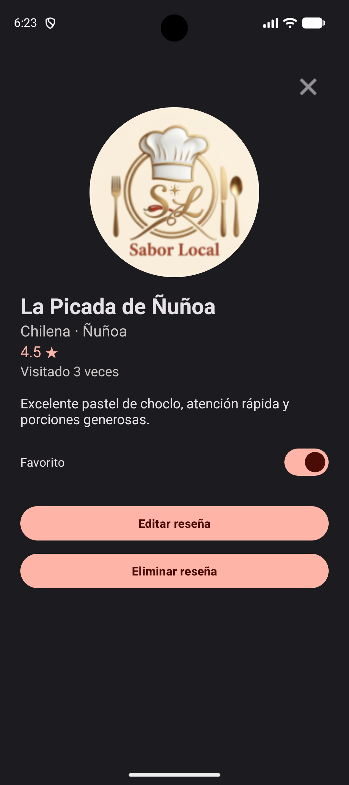 |
| **Recomendaciones IA** | 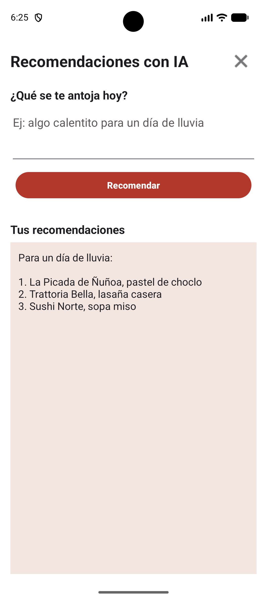 | 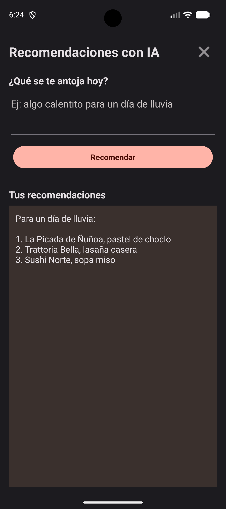 |